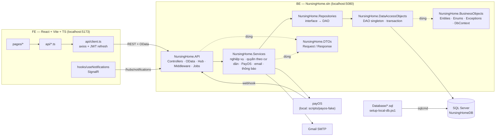
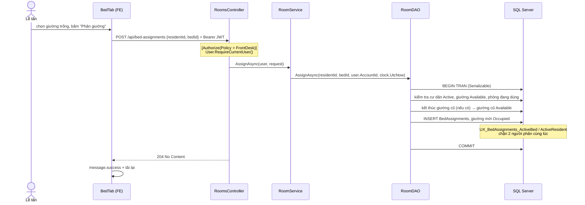
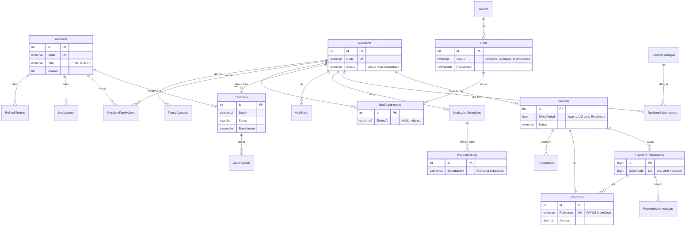
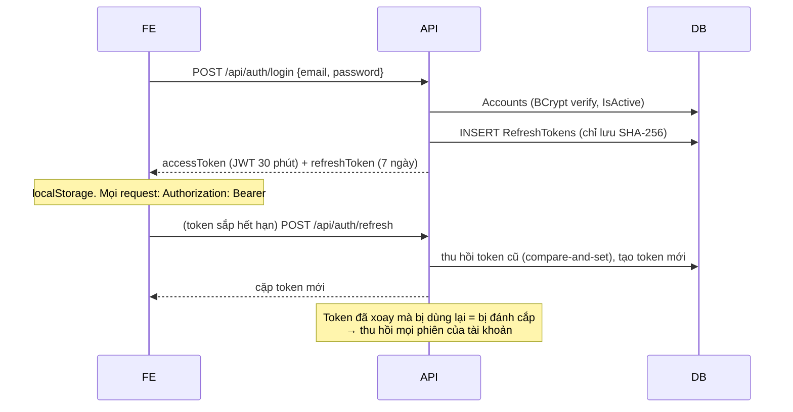
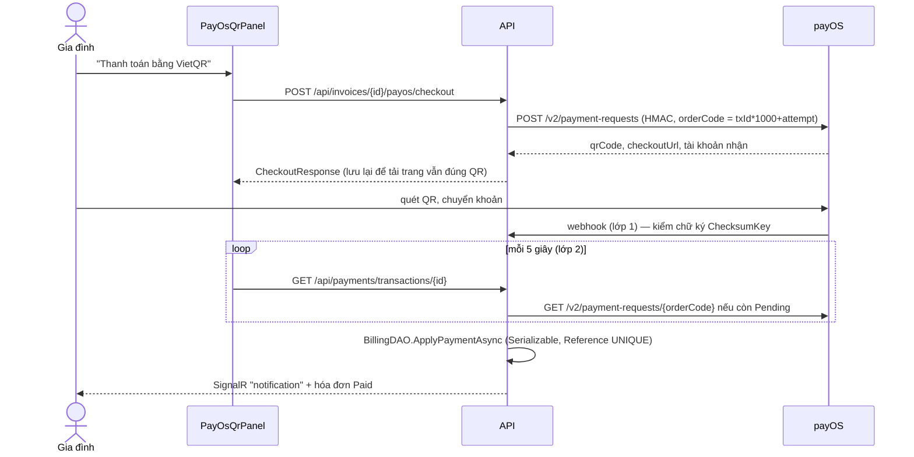

# Kiến trúc dự án — đọc trong 30 phút

Tài liệu này giúp bạn hiểu dự án trước khi nhận task. Đọc theo thứ tự: mục 1 → 2 (lần theo một request thật trong code) → 3 (ERD) → 6 (điểm mở rộng). Cài đặt máy: [HANDOVER.md](HANDOVER.md) mục 1. Danh sách task: [tasks/README.md](tasks/README.md).

## 1. Bức tranh tổng thể

Quy tắc phụ thuộc (project reference): `API → Services → Repositories → DAO → BusinessObjects`; `API, Services → DTOs`. **DTOs không biết entity, Services không biết HttpContext/SignalR** (API cài đặt `INotificationPublisher`).

| Layer | Một câu | File mẫu nên đọc |
| --- | --- | --- |
| API | Nhận request, lấy người gọi từ JWT, gọi 1 service, trả DTO | `Controllers/RoomsController.cs` |
| Services | Kiểm tra quyền + quy tắc nghiệp vụ, map entity → DTO, gửi thông báo | `Implementations/RoomService.cs`, `ResidentAccessService.cs` |
| Repositories | Một dòng gọi DAO (giống ASS2) | `Implementations/ResidentRepositories.cs` |
| DAO | Truy vấn EF; thao tác nhiều bước = một method trong một transaction | `RoomDAO.AssignAsync`, `BillingDAO.ApplyPaymentAsync` |
| BusinessObjects | Entity, enum, exception dùng chung, mapping EF (không migration) | `NursingHomeContext.cs`, `Entities/Room.cs` |
| DTOs | Hợp đồng dữ liệu với FE, có DataAnnotations để validate | `DTOs/Rooms/RoomDtos.cs` |
| Database | Nguồn sự thật của schema + seed | `Database/01_Schema.sql` |

## 2. Lần theo một request: "Phân giường cho cư dân" (UC-37)

Mở từng file theo thứ tự dưới đây, bạn sẽ thấy toàn bộ khuôn mẫu mà mọi task sau phải làm theo.

| Bước | File | Điểm cần để ý |
| --- | --- | --- |
| FE gọi API | `FE/src/pages/Staff/resident/Tabs.tsx` → `BedTab`, `FE/src/api/rooms.ts` | Lỗi luôn qua `extractErrorMessage(e)` |
| Axios | `FE/src/api/client.ts` | Tự gắn Bearer, tự refresh khi token sắp hết hạn |
| Controller | `BE/NursingHome.API/Controllers/RoomsController.cs` → `Assign` | Policy ở action; controller không có logic |
| Service | `BE/NursingHome.Services/Implementations/RoomService.cs` → `AssignAsync` | Lấy giờ từ `FacilityClock`, không dùng `DateTime.Now` |
| DAO | `BE/NursingHome.DataAccessObjects/RoomDAO.cs` → `AssignAsync` | Kiểm tra + ghi trong cùng transaction; lỗi nghiệp vụ ném `BusinessRuleException` |
| DB | `Database/01_Schema.sql` mục 3 | Filtered unique index là chốt chặn cuối |
| Lỗi → HTTP | `BE/NursingHome.API/Middleware/ExceptionHandlingMiddleware.cs` | `BusinessRuleException` → 400, trùng unique → 409 |

Một ví dụ "đọc dữ liệu có kiểm quyền" để so sánh: `HealthService.ListAsync` gọi `access.RequireAsync(user, residentId, ResidentSection.Health)` trước khi đọc. **Mọi service đọc dữ liệu của một cư dân đều phải làm vậy.**

## 3. Sơ đồ dữ liệu (21 bảng lõi)

Bảng của module Sprint 3+ nằm ở `01_Schema.sql` mục 9 (Viên) / mục 10 (Huy), ví dụ `Inquiries` (yêu cầu tư vấn) 1–n `TourBookings` (lịch tham quan), `Inquiries.ResidentId` trỏ về `Residents` khi khách nhập viện.

Chi tiết cột, CHECK và index: `Database/01_Schema.sql`. Quy ước: khóa `INT IDENTITY` (log dùng `BIGINT`), enum lưu `NVARCHAR` + `CHECK`, tiền `DECIMAL(18,0)`, thời điểm `DATETIME2` UTC, ngày `DATE`, giờ `TIME(0)`, FK `NO ACTION` (không xóa dây chuyền).

## 4. Xác thực & phân quyền

JWT mang claim ngắn `sub, name, email, role` (`DTOs/Auth/AuthDtos.cs` → `AuthClaimTypes`). Controller lấy `CurrentUser` bằng `User.RequireCurrentUser()` rồi truyền xuống service. Hai lớp phân quyền:

1. **Policy theo role** ở controller (`API/Security/AuthPolicies.cs`). Policy ở class và action là **AND**.
2. **Quyền theo từng cư dân** ở service (`IResidentAccessService`): bảng quyền chi tiết ở [HANDOVER.md mục 3](HANDOVER.md#3-phân-quyền).

## 5. Thanh toán PayOS và thông báo realtime

Thông báo: service gọi `INotificationService.NotifyAsync(...)` → lưu bảng `Notifications` → `SignalRNotificationPublisher` đẩy sự kiện `notification` tới user (id = claim `sub`) qua `/hubs/notifications`. FE: `hooks/useNotifications.ts` (chuông ở header).

## 6. Điểm mở rộng cho 2 module (đọc kỹ trước khi code)

Từ Sprint 3, code mới chia làm 2 module để Viên và Huy làm song song mà không sửa cùng file:

| Module | Người phụ trách | Phạm vi |
| --- | --- | --- |
| **Operations** — Vận hành & Tài chính | Viên | tiếp nhận/tham quan, ca trực, bàn giao ca, báo cáo, tài chính mở rộng, chat, AI hạ tầng |
| **Care** — Chăm sóc & Gia đình | Huy | sự cố, bệnh nền/dị ứng/chế độ ăn, lịch thăm, kế hoạch chăm sóc, ADL, bữa ăn, đánh giá, phản hồi, AI cho gia đình |

| Việc cần làm | Operations (Viên) | Care (Huy) |
| --- | --- | --- |
| Bảng SQL | `01_Schema.sql` **mục 9** (chèn trên dòng KẾT THÚC) | `01_Schema.sql` **mục 10** |
| Dữ liệu demo | `05_DemoSeed.sql` mục 10, Id 100–499 ở bảng dùng chung | `05_DemoSeed.sql` mục 11, Id 500–899 |
| Entity | `BusinessObjects/Entities/Operations*.cs` | `BusinessObjects/Entities/Care*.cs` (file mới, vd. `CareIncidents.cs`) |
| DbSet + mapping | `NursingHomeContext.Operations.cs` | `NursingHomeContext.Care.cs` |
| DAO, Repository | file mới trong project tương ứng | file mới |
| Interface service | `Services/Interfaces/IOperationsServices.cs` | `Services/Interfaces/ICareModuleServices.cs` |
| Map entity → DTO | `OperationsMapper` (partial): mỗi task một file `Helpers/OperationsMapper.<Task>.cs`, vd. `OperationsMapper.Admissions.cs` | `CareMapper` trong `Helpers/ModuleMappers.cs` (có thể đổi thành `partial` và tách file như bên Operations) |
| Đăng ký DI | `ServiceCollectionExtensions.Operations.cs` | `ServiceCollectionExtensions.Care.cs` |
| Entity set OData | `API/OData/EdmModelBuilder.Operations.cs` | `EdmModelBuilder.Care.cs` |
| Controller, DTO | file mới | file mới |
| Kiểu TS | `FE/src/types/operations.ts` | `FE/src/types/care.ts` |
| Route + menu | `FE/src/modules/operations.tsx` | `FE/src/modules/care.tsx` |
| Nhãn trạng thái | `FE/src/utils/status.operations.ts` | `FE/src/utils/status.care.ts` |
| Trang | `FE/src/pages/Operations/` | `FE/src/pages/Care/` (+ `pages/Family/` cho trang gia đình mới) |

File lõi dùng chung (chỉ sửa khi task yêu cầu, báo người kia trước và PR riêng nhỏ): `Enums.cs`, `NursingHomeContext.cs`, `DtoMapper.cs`, `IServices.cs`, `Program.cs`, `AuthPolicies.cs`, `ResidentAccessService.cs`, `Options.cs`, `FE/src/types/index.ts`, `FE/src/App.tsx`, `FE/src/layouts/*`. Danh sách file mỗi người được sửa: [tasks/README.md](tasks/README.md#quyền-sở-hữu-file).

## 7. Danh mục API hiện có (Sprint 0–2)

Tất cả trả JSON camelCase; lỗi `{ "message": "..." }`. Swagger: `http://localhost:5080/swagger` (nút Authorize dán `accessToken`).

| Nhóm | Method + đường dẫn | Policy |
| --- | --- | --- |
| Auth | `POST /api/auth/login`, `refresh`, `logout`, `forgot-password`, `reset-password` | ẩn danh (rate limit) |
| | `POST /api/auth/change-password`, `GET/PUT /api/auth/me` | đăng nhập |
| Tài khoản | `GET /odata/Accounts`, `GET/PUT /api/accounts/{id}`, `POST /api/accounts`, `POST /api/accounts/{id}/reset-password` | AdminOnly |
| | `GET /api/accounts/lookup?roles=Caregiver,Nurse` | Staff |
| Cư dân | `GET /odata/Residents`, `GET /api/residents/{id}`, `GET /api/residents/{id}/contacts` | Staff |
| | `POST/PUT /api/residents`, `POST /{id}/discharge`, contacts `POST/PUT/DELETE`, `GET/PUT/DELETE /{id}/family-links`, `POST /{id}/release-bed`, `GET /{id}/bed-history` | FrontDesk |
| | `GET /api/residents/{id}/vitals?from&to`, `GET /{id}/medication-logs` | ClinicalStaff |
| | `GET /api/residents/{id}/subscriptions` | BillingStaff |
| Phòng | `GET /api/rooms`, `GET /api/rooms/{id}` | Staff |
| | `POST/PUT/DELETE /api/rooms`, `/api/rooms/{id}/beds[/{bedId}]`, `POST/GET /api/bed-assignments` | FrontDesk |
| Chăm sóc | `GET /odata/CareTasks?date&mine&residentId`, `GET /api/care-tasks/{id}`, `POST /{id}/updates`, `GET /{id}/records`, `POST /api/vitals` | ClinicalStaff |
| | `POST /api/care-tasks` | CarePlanners |
| Thuốc | `GET /api/medication-schedules?residentId`, `GET /api/medications/today?date`, `POST /api/medication-logs` | ClinicalStaff |
| | `POST /api/medication-schedules`, `POST /{id}/stop` | Prescribers |
| Gói, hóa đơn | `GET /api/service-packages` | Staff |
| | `POST/PUT /api/service-packages` | AdminOnly |
| | `GET/POST /api/subscriptions`, `POST /{id}/end`, `GET /odata/Invoices`, `POST /api/invoices`, `/{id}/items`, `/{id}/issue` | BillingStaff |
| | `POST /api/invoices/{id}/payments`, `/{id}/cancel` | FinanceStaff |
| | `GET /api/invoices/{id}`, `POST /{id}/payos/checkout` | InvoiceReaders |
| PayOS | `GET /api/payments/transactions/{id}` | InvoiceReaders |
| | `POST /api/payments/payos/webhook` | ẩn danh (chữ ký) |
| | `POST /api/payments/transactions/{id}/sync`, `GET /api/payments/webhook-logs`, `GET /odata/PaymentTransactions` | FinanceStaff |
| Gia đình | `GET /api/family/residents`, `GET /api/family/residents/{id}` | FamilyOnly |
| Tổng quan | `GET /api/dashboard` | BillingStaff |
| | `GET /api/public/overview` | ẩn danh |
| Thông báo | `GET /api/notifications`, `POST /{id}/read`, `POST /read-all`, hub `/hubs/notifications` | đăng nhập |

Sprint 3+ (module):

| Nhóm | Method + đường dẫn | Policy |
| --- | --- | --- |
| Tiếp nhận (S3-V1) | `POST /api/public/inquiries`, `POST /api/public/tour-bookings` | ẩn danh, rate limit `PublicForms` (5/phút/IP) |
| | `GET /api/public/tour-slots?from&to` (chỉ số chỗ còn lại) | ẩn danh |
| | `GET /odata/Inquiries`, `PUT /api/inquiries/{id}`, `POST /{id}/admit`, `GET /api/tour-bookings?from&to`, `POST /api/tour-bookings/{id}/confirm` · `cancel` · `done` · `no-show` | FrontDesk |
| Ca trực (S3-V2) | `GET /api/shifts`, `GET /api/shift-assignments/mine?days=14` | Staff |
| | `GET /api/shift-assignments?from&to` (Admin/Nurse thấy tất cả, Doctor/Caregiver chỉ của mình), `GET /api/care-assignments?residentId&accountId&activeOnly` (Caregiver chỉ của mình) | ClinicalStaff |
| | `POST /api/shift-assignments`, `DELETE /{id}`, `POST /copy-week` | AdminOnly |
| | `POST /api/care-assignments`, `POST /{id}/end` | CarePlanners |
| Nghỉ phép & bàn giao (S3-V4) | `GET /api/leave-requests?status` (Admin thấy tất cả; người khác: đơn của mình + đơn xin đổi ca với mình), `POST /api/leave-requests`, `GET /swap-candidates?shiftAssignmentId`, `POST /{id}/cancel` (chủ đơn) | ClinicalStaff |
| | `POST /api/leave-requests/{id}/approve` · `reject` | AdminOnly |
| | `GET /api/handovers/draft?shiftId&date`, `GET /api/handovers?date`, `GET /api/handovers/inbox`, `POST /api/handovers`, `POST /{id}/acknowledge` | ClinicalStaff |
| Tài chính mở rộng (S3-V5) | `GET /api/extra-services?activeOnly` | Staff |
| | `POST /api/extra-services`, `PUT /{id}` | AdminOnly |
| | `GET /api/service-usages?from&to`, `GET·POST /api/residents/{id}/service-usages`, `DELETE /api/service-usages/{id}` (chỉ khi chưa vào hóa đơn) | ServiceRecorders (Admin, Receptionist, Accountant, Nurse, Caregiver) |
| | `POST /api/invoices/batch`, `GET /api/invoices/{id}/reminders` | BillingStaff |
| | `GET /api/invoices/{id}/pdf` (Family: như xem hóa đơn) | InvoiceReaders |
| | `POST /api/invoices/reminders/run` (job `InvoiceReminderJob` cũng chạy mỗi giờ) | FinanceStaff |
| Báo cáo (S3-V3) | `GET /api/reports/revenue?year` · `/revenue/export` (.xlsx) | FinanceStaff |
| | `GET /api/reports/occupancy?year` · `/occupancy/export` | BillingStaff |
| | `GET /api/reports/medication-adherence?from&to` · `/medication-adherence/export` | Prescribers |

**OData chỉ dùng attribute routing** (`Program.cs` bỏ các convention theo tên controller): mỗi entity set cần một `ODataController` có `[Route("odata/TenEntitySet")]`. Controller REST trùng tên entity set (vd. `InvoicesController`) không còn bị OData bắt nhầm.

## 8. Frontend trong 1 phút

- `main.tsx`: `ConfigProvider` (tiếng Việt, màu chủ đạo) → `App` của antd (để dùng `App.useApp()` lấy `message`/`modal`) → Router → `AuthProvider`.
- `App.tsx`: route lõi + `{operationsAppRoutes}` / `{careAppRoutes}` từ `src/modules/`. Trang import bằng `lazy()`.
- Trang lấy dữ liệu theo mẫu: `const load = useCallback(async () => {...}, [deps]); useEffect(() => { void load(); }, [load]);`
- Danh sách lớn: `odataList<T>('EntitySet', { filter, orderBy, top, skip })` trả `{ items, total }` cho `Table` phân trang.
- Không dùng thư viện state toàn cục; dữ liệu mỗi trang tự tải. Người dùng hiện tại: `useAuth().user` (`role`, `accountId`).
- Ẩn/hiện nút theo role bằng `hasRole(user?.role, FRONT_DESK)`… (`auth/roles.ts`); API vẫn chặn lại.
