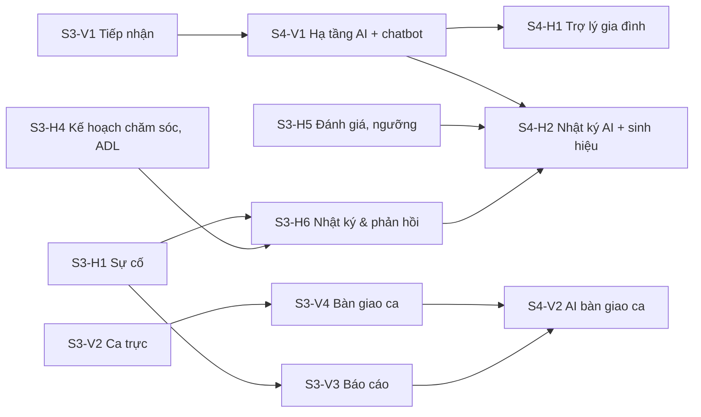

# Bảng task Scrum — Viên & Huy

Sprint 0–2 đã xong (56/142 use case, xem [../SPRINTS.md](../SPRINTS.md)). Còn 86 use case: 16 task chính chia đều cho **Viên** và **Huy** trong 3 sprint, phần còn lại nằm ở [BACKLOG.md](BACKLOG.md) (làm khi xong sớm).

> **Giả định hạn nộp ~14/12/2026.** Nếu hạn khác, giữ nguyên thứ tự task và co giãn số tuần; task **Must** không được cắt.

## Đọc trước khi nhận task

1. [../HANDOVER.md](../HANDOVER.md) mục 1 — cài máy, chạy được API + FE + PayOS giả lập.
2. [../ARCHITECTURE.md](../ARCHITECTURE.md) — kiến trúc, lần theo request "phân giường", ERD, **mục 6: điểm mở rộng cho 2 module**.
3. [../HANDOVER.md](../HANDOVER.md) mục 3–5 — phân quyền, quy ước, ví dụ thêm một use case qua từng layer.
4. File task của bạn (bảng dưới). Mỗi file có: tiêu chí hoàn thành, DDL để dán vào schema, file cần tạo, API, màn hình, cách kiểm thử.

## Lịch

| Sprint | Thời gian | Mục tiêu | Mốc kiểm tra |
| --- | --- | --- | --- |
| Chuẩn bị | 14–15/11 | Huy cài máy, đọc tài liệu, làm bài khởi động (bên dưới) | Huy chạy được smoke test 31/31 |
| **3** | 16/11 – 29/11 | Module mới. Tuần 1: các task **Must**; tuần 2: **Should** | 20/11: merge Must vào `develop` · 29/11: sprint review |
| **4** | 30/11 – 06/12 | AI: hạ tầng, chatbot tư vấn, trợ lý gia đình, nhật ký AI | 02/12: hạ tầng AI (S4-V1 phần 1) merge để Huy dùng |
| **5** | 07/12 – 13/12 | Hoàn thiện, QA từng role, seed demo, slide, tổng duyệt | 11/12: đóng băng tính năng · 12/12: tổng duyệt |

## Bảng task

Trạng thái: `Chưa làm` → `Đang làm` → `Chờ review` → `Xong`. Người làm tự cập nhật cột này khi mở/merge PR.

| ID | Task | Use case | Người | Ưu tiên | Điểm | Tuần | Phụ thuộc | Trạng thái |
| --- | --- | --- | --- | --- | --- | --- | --- | --- |
| S3-00 | Điểm mở rộng 2 module (partial file, vùng SQL, `src/modules`) | — | (đã làm) | — | — | — | — | Xong |
| [S3-V1](S3-V1-tiep-nhan-tham-quan.md) | Tiếp nhận & đặt lịch tham quan | UC-17, 18, 21, 22 | Viên | Must | 5 | 3.1 | — | Chờ review |
| [S3-V2](S3-V2-ca-truc-phu-trach.md) | Ca trực & phân công phụ trách | UC-44, 45, 46 | Viên | Must | 5 | 3.1 | — | Chưa làm |
| [S3-V3](S3-V3-bao-cao.md) | Báo cáo + xuất Excel | UC-122, 123, 124, 125, 128 | Viên | Must/Should | 5 | 3.1–3.2 | UC-125 cần S3-H1 | Chưa làm |
| [S3-V4](S3-V4-ban-giao-ca-nghi-phep.md) | Nghỉ phép/đổi ca & bàn giao ca | UC-47, 49 | Viên | Should | 5 | 3.2 | S3-V2 | Chưa làm |
| [S3-V5](S3-V5-tai-chinh-mo-rong.md) | Dịch vụ phát sinh, hóa đơn hàng loạt, PDF, nhắc nợ, email | UC-85, 86, 88, 97, 98, 118 | Viên | Should | 8 | 3.2 | — | Chưa làm |
| [S3-V6](S3-V6-chat-gia-dinh.md) | Chat gia đình – nhân viên | UC-106 | Viên | Should | 5 | 3.2 | — | Chưa làm |
| [S3-H1](S3-H1-su-co.md) | Báo cáo & xử lý sự cố | UC-58, 59, 107 | Huy | Must | 5 | 3.1 | — | Chưa làm |
| [S3-H2](S3-H2-benh-nen-di-ung-che-do-an.md) | Bệnh nền, dị ứng, chế độ ăn, cảnh báo dị ứng | UC-66, 71, 82 | Huy | Must/Should | 5 | 3.1 | — | Chưa làm |
| [S3-H3](S3-H3-lich-tham.md) | Đặt & duyệt lịch thăm | UC-103, 104 | Huy | Must | 5 | 3.1 | — | Chưa làm |
| [S3-H4](S3-H4-ke-hoach-cham-soc-adl-bua-an.md) | Kế hoạch chăm sóc tự sinh việc, ADL, bữa ăn, nhắc việc | UC-51, 56, 57, 61 | Huy | Should | 8 | 3.2 | — | Chưa làm |
| [S3-H5](S3-H5-danh-gia-phieu-kham-nguong.md) | Đánh giá định kỳ, phiếu khám, ngưỡng sinh hiệu riêng | UC-64, 67, 68 | Huy | Should | 5 | 3.2 | — | Chưa làm |
| [S3-H6](S3-H6-nhat-ky-phan-hoi-gia-dinh.md) | Nhật ký hằng ngày cho gia đình & phản hồi | UC-108, 109, 110 | Huy | Should | 5 | 3.2 | S3-H1, S3-H4 | Chưa làm |
| [S4-V1](S4-V1-ai-ha-tang-chatbot.md) | Hạ tầng AI + chatbot tư vấn công khai | AI-01, UC-20 | Viên | Must | 8 | 4 | S3-V1 | Chưa làm |
| [S4-V2](S4-V2-ai-ban-giao-ca-bao-cao.md) | AI tóm tắt bàn giao ca (+ hỏi đáp báo cáo) | AI-04, AI-12 | Viên | Should | 5 | 4 | S3-V4, S3-V3, S4-V1 | Chưa làm |
| [S4-H1](S4-H1-ai-tro-ly-gia-dinh.md) | Trợ lý AI cho gia đình | AI-02 | Huy | Must | 5 | 4 | S4-V1 (phần 1) | Chưa làm |
| [S4-H2](S4-H2-ai-nhat-ky-sinh-hieu.md) | Nhật ký hằng ngày bằng AI + diễn giải sinh hiệu | AI-03, AI-06 | Huy | Should | 5 | 4 | S3-H4, S3-H5, S3-H6, S4-V1 | Chưa làm |
| [S5-V1](S5-V1-hoan-thien.md) | Hoàn thiện module Vận hành & Tài chính, slide, kịch bản demo | — | Viên | Must | 5 | 5 | tất cả | Chưa làm |
| [S5-H1](S5-H1-hoan-thien.md) | Hoàn thiện module Chăm sóc & Gia đình, test, video dự phòng | — | Huy | Must | 5 | 5 | tất cả | Chưa làm |

**Tổng điểm:** Viên 33 (S3) + 13 (S4) + 5 (S5) = 51 · Huy 33 (S3) + 10 (S4) + 5 (S5) = 48. Một điểm ≈ nửa ngày làm việc (đã gồm test và seed).



## Bài khởi động cho Huy (14–15/11, không tính điểm)

- [ ] Cài máy theo [HANDOVER.md](../HANDOVER.md) mục 1, đăng nhập được bằng 9 tài khoản demo.
- [ ] Chạy `.\scripts\run-smoke-isolated.ps1` → "TẤT CẢ PASS".
- [ ] Lần theo luồng "phân giường" ở [ARCHITECTURE.md](../ARCHITECTURE.md) mục 2 bằng breakpoint trong Visual Studio/Rider.
- [ ] Đăng nhập `family2`, trả hóa đơn bằng VietQR qua `http://localhost:5199/dev`, xem chuông thông báo đổi realtime.
- [ ] Thử sửa nhỏ để quen quy trình PR: thêm cột "SĐT" vào bảng Tài khoản (`FE/src/pages/Admin/Accounts.tsx`), mở PR vào `develop`, Viên review.

## Quyền sở hữu file

Mỗi người chỉ sửa file trong cột của mình. File "lõi" cần sửa thì nhắn người kia trước và tách PR nhỏ riêng.

| Vùng | Viên (Operations) | Huy (Care) |
| --- | --- | --- |
| SQL | `01_Schema.sql` mục 9, `05_DemoSeed.sql` mục 10 (Id 100–499), `02_Views_Functions.sql`, `03_StoredProcedures.sql`, `04_ReferenceData.sql` | `01_Schema.sql` mục 10, `05_DemoSeed.sql` mục 11 (Id 500–899) |
| BE mới | `Entities/Operations*.cs`, `NursingHomeContext.Operations.cs`, `ServiceCollectionExtensions.Operations.cs`, `IOperationsServices.cs`, `OperationsMapper`, `EdmModelBuilder.Operations.cs`, `BackgroundJobs/` của mình | các file `*.Care.cs`, `Entities/Care*.cs`, `ICareModuleServices.cs`, `CareMapper` |
| BE lõi đã có | Billing, Payment, Room, Resident, Account, Auth, Dashboard (DAO/Service/Controller) | Care, Health, Medication (`CareDAO`, `MedicationDAO`, `CareServices.cs`, `CareController.cs`) |
| FE mới | `src/modules/operations.tsx`, `types/operations.ts`, `utils/status.operations.ts`, `pages/Operations/` | `src/modules/care.tsx`, `types/care.ts`, `utils/status.care.ts`, `pages/Care/` |
| FE lõi đã có | `pages/Admin`, `pages/Billing`, `pages/Staff/Residents.tsx`, `ResidentDetail.tsx`, `resident/Tabs.tsx`, `Rooms.tsx`, `pages/Family/FamilyInvoice.tsx`, `PaymentResult.tsx`, `components/PayOsQrPanel.tsx`, `api/billing|accounts|rooms|residents.ts` | `pages/Staff/CareTasks.tsx`, `Medications.tsx`, `resident/ClinicalTabs.tsx`, `components/CareTaskModals.tsx`, `VitalsChart.tsx`, `pages/Family/FamilyHome.tsx`, `FamilyResident.tsx`, `api/care.ts`, `api/portal.ts` |
| Lõi dùng chung (báo trước) | `Enums.cs`, `NursingHomeContext.cs`, `DtoMapper.cs`, `IServices.cs`, `Program.cs`, `AuthPolicies.cs`, `ResidentAccessService.cs`, `Options.cs`, `appsettings.json`, `types/index.ts`, `App.tsx`, `layouts/*`, `auth/*` | (như cột trái) |

Thêm một **tab** vào hồ sơ cư dân: tab chăm sóc/y tế → Huy sửa `ClinicalTabs.tsx` + một dòng trong `ResidentDetail.tsx`; tab hành chính/tài chính → Viên sửa `Tabs.tsx`. Thêm role vào policy hoặc option mới vào `Options.cs`/`appsettings.json` → PR riêng 1–2 dòng.

## Quy trình làm một task

```powershell
git checkout develop; git pull
git checkout -b feature/s3-v1-admissions          # feature/<id>-<ten-ngan>
# 1. SQL (vùng của mình) → .\Database\setup-local-db.ps1   (bảng mới được tạo, dữ liệu cũ giữ nguyên)
# 2. BE: Entity → mapping → DAO → Repository → DTO → Service → Controller → đăng ký DI
# 3. dotnet build BE/NursingHome.sln  (0 lỗi, 0 cảnh báo) ; thử bằng Swagger
# 4. FE: types → api → trang → modules/<module>.tsx (route + menu) → npm run build && npm run lint
# 5. Seed demo (vùng của mình), thêm check(...) vào scripts/smoke-test.mjs
# 6. .\Database\setup-local-db.ps1 -Recreate ; chạy smoke test ; thử tay với role được phép VÀ bị chặn
git add -A; git commit -m "feat(admissions): UC-17 UC-18 dat lich tham quan"
git push -u origin feature/s3-v1-admissions       # mở PR vào develop, người kia review
```

- **Review chéo bắt buộc**: Viên review PR của Huy và ngược lại. Người review chạy `setup-local-db.ps1 -Recreate` + smoke test trên máy mình trước khi approve.
- **Merge sớm, merge nhỏ**: mỗi task 1 PR; task 8 điểm có thể chia 2 PR (BE trước, FE sau).
- Sau khi merge: cập nhật cột Trạng thái ở bảng trên và ở [../SPRINTS.md](../SPRINTS.md).
- Xung đột ở `05_DemoSeed.sql`/`01_Schema.sql`: mỗi người chỉ chèn trong vùng của mình nên git thường tự gộp; nếu xung đột, giữ cả hai khối.

## Nghi thức Scrum cho 2 người

| Khi nào | Làm gì | Thời lượng |
| --- | --- | --- |
| Thứ Hai đầu sprint | Planning: đọc lại file task, chốt tiêu chí hoàn thành, hỏi chỗ chưa rõ | 30 phút |
| Mỗi tối | Nhắn nhóm 3 dòng: hôm nay xong gì, mai làm gì, đang vướng gì | 5 phút |
| Thứ Sáu tuần 1 | Mốc merge Must, dựng DB mới, demo chéo trên máy người kia | 30 phút |
| Chủ Nhật cuối sprint | Review (demo theo kịch bản) + retro (1 điều giữ, 1 điều đổi) | 45 phút |

## Thêm task mới

Sao chép [_TEMPLATE.md](_TEMPLATE.md), đặt tên `S<sprint>-<V|H><số>-<ten>.md`, thêm một dòng vào bảng trên.
